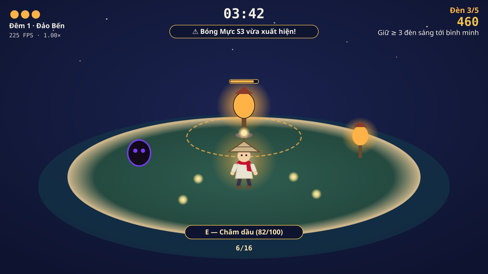

# Đảo Đèn Lồng (v1.0.0)

> **Video demo (`.mp4` < 5 phút):** [Xem trong GitHub Release `v1.0.0`](https://github.com/hoangnam2612/K5-L3A-DAY12-HoangHaiNam-2A202603694-AI-SDLC-Dao-Den-Long/releases/tag/v1.0.0) _(hoặc `docs/demo/demo.mp4` khi đính kèm)_



Game 3D góc nhìn thứ ba đêm huyền ảo: bé **Mây** (đội chiếc nón lá rộng vành có gắn đèn lồng nhỏ) đi gom đom đóm để giữ cho các **Đèn Lồng Lớn** sáng tới bình minh qua **3 Đêm** (Đảo Bến, Đảo Cau, Đảo Chuông). Đèn hao dầu liên tục và có thể tắt, **Bóng Mực** kéo tới hút dầu; bạn còn phải tránh **Gió Lạc**, **gió mạnh** và **lốc xoáy**. Làm bằng TypeScript + Three.js + Vite; lõi mô phỏng tất định có chế độ headless, benchmark và soak test theo **Test Contract v1.3**.

---

## Yêu cầu hệ thống

- **Node.js** `20+` (đã kiểm trên Node `20` và `24`).
- **Hệ điều hành:** macOS, Linux hoặc Windows (chạy trên trình duyệt WebGL bất kỳ: Chrome, Chromium, Edge, Firefox, Safari).
- Không cần cài thêm cơ sở dữ liệu hay công cụ ngoài.

---

## Cài đặt và chạy (tối đa 2 lệnh)

```bash
npm install
npm run dev
```

Mở địa chỉ Vite in ra (mặc định `http://localhost:5173`).
- Tạo bản build web tĩnh cho phát hành: `npm run build` (thư mục `dist/`).
- Xuất bảng xếp hạng cục bộ ra file JSON: `npx tsx scripts/run.ts --export-leaderboard out.json`.

---

## Điều khiển (có thể đổi phím trong Cài đặt)

| Phím mặc định | Hành động |
|---|---|
| `W` `A` `S` `D` | Di chuyển 4 hướng (theo hướng camera) |
| Chuột (hoặc `←` `→`) | Xoay camera; độ nhạy chỉnh trong Cài đặt |
| `Space` | Nhảy (chỉ khi chạm đất) |
| `E` | Tương tác với đèn gần nhất: thắp đèn tắt, hoặc **châm dầu** cho đèn đang sáng chưa đầy |
| `Q` | **Tỏa Sáng**: làm choáng và đẩy lùi Bóng Mực (tốn 3 đom đóm) |
| `F` | **Lướt** 14 m/s trong 0.2 s (hồi 1.5 s, **không bất tử**) |
| `Esc` / `P` | Tạm dừng (Tiếp tục / Chơi lại Đêm / Cài đặt / Về menu) |
| `Enter` | Xác nhận nhanh ở các màn hình |

> Mọi phím hành động đều có thể đổi trong **Cài đặt → Đổi phím điều khiển**, có phát hiện trùng phím và nút **Khôi phục mặc định**.

---

## Luật chơi và điểm (Ticket-02, Ticket-03 & Ticket-04)

- **Điều kiện thắng:** Còn sống lúc bình minh (`240 / 270 / 300 s`) **và** số đèn đang sáng $\ge \lceil 0.6 \times \text{tổng đèn}\rceil$ (`3/5`, `4/6`, `5/7`). Thắp đủ đèn không kết thúc Đêm sớm.
- **Điều kiện thua:** Hết Ngọn Lửa (`3`, hồi đầy mỗi Đêm) hoặc hết giờ mà số đèn sáng dưới ngưỡng.
- **Nhiên liệu đèn:** Đèn vừa thắp có `100` dầu, hao `1.0` dầu/giây; hết dầu là tắt (`lantern_out`). Nhấn `E` cạnh đèn đang sáng để châm dầu (`+10` dầu/đom đóm). Đèn đã từng sáng chỉ tốn `5` đom đóm để thắp lại (đèn mới tốn `10`). Đèn dưới `30` dầu nhấp nháy `1 Hz` và mất vùng an toàn `6 m`.
- **Sức chứa đom đóm:** `10 + 2 × successful_lights` (tối đa `20`), tăng mỗi lần thắp đèn thành công trong Đêm.
- **Bóng Mực:** Chạm vào làm Mây mất `1` Ngọn Lửa, rơi nửa số đom đóm đang mang, bất tử `1.5 s`. Bóng ở trạng thái `wander` ưu tiên tìm tới đèn yếu (`fuel < 30`) gần nhất để đứng hút `5` dầu/giây (`drain`).
- **Điểm số:** Nạp đom đóm `+5` · Thắp lần đầu `+100` · Thắp lại `+40` · Choáng Bóng Mực `+5` (`+15` nếu đang `drain`) · Thưởng bình minh khi thắng: mỗi đèn sáng `+50 + floor(fuel)`, mỗi Ngọn Lửa còn lại `+50`.

---

## Test, Headless, Benchmark, Soak Test & Bảng xếp hạng (Contract v1.3)

```bash
# 1. Chạy toàn bộ 227 unit & scenario tests + kiểm tra kiểu TypeScript
npm test
npm run typecheck

# 2. Chế độ headless (Contract v1.0 - v1.3)
npx tsx src/headless/cli.ts --seed 1 --night 1 --ticks 600 --out out/run.jsonl

# 3. Chế độ benchmark 3D (1280x720, tắt vsync, 200 Bóng Mực + 100 đom đóm, 3s warmup + 30s đo)
npx tsx scripts/bench.ts --seed 42 --duration 30 --out bench.json

# 4. Soak test (chạy liên tiếp 10 Đêm xoay vòng trong cùng 1 tiến trình)
npx tsx scripts/soak.ts --seed 7 --nights 10 --out soak.json

# 5. Xuất bảng xếp hạng cục bộ (top 10)
npx tsx scripts/run.ts --export-leaderboard out.json
```

- **Về VSync trong Benchmark:** `scripts/bench.ts` tự động khởi chạy Chrome/Chromium ở cửa sổ `1280×720` với cờ `--disable-frame-rate-limit --disable-gpu-vsync` (`vsync_off: true`). Nếu chạy trên môi trường server không có trình duyệt, script tự chuyển sang chế độ đo đồ thị cảnh 3D Three.js + sim để không bị treo.

---

## Dễ tiếp cận (Accessibility) & Bảng xếp hạng

- **Bảng xếp hạng cục bộ:** Lưu Top 10 (`name`, `score`, `nights_won`, `achieved_at` chuẩn ISO 8601 có múi giờ, `seed`) trên cả đĩa cục bộ (`data/leaderboard.json`) và `localStorage`. Hỗ trợ tên `3–12` ký tự `[A-Za-z0-9_]` và tiếng Việt có dấu.
- **Đổi phím & phát hiện trùng phím:** Đổi toàn bộ 9 hành động trong Cài đặt.
- **Phụ đề & chỉ báo hình ảnh:** Hiển thị phụ đề trực quan khi Bóng Mực xuất hiện (kèm mũi tên đỏ chỉ hướng ở mép màn hình), gió mạnh sắp thổi, đếm ngược 10 giây cuối, và đèn có `fuel < 30`.
- **Giảm chuyển động & Chữ lớn:** Tùy chọn tắt rung camera/chớp màn hình; cỡ chữ UI cơ sở `18 px` kèm tùy chọn **Chữ lớn (`×1.25`)** và **Bảng màu dễ phân biệt (mù màu)**.

---

## Sáng tạo của tôi

Các phần thêm ngoài đề, **tắt hoàn toàn trong chế độ headless, benchmark và soak test** để không làm đổi số đo hay đầu ra Test Contract:
- **Mô hình nhân vật Mây sống động:** Dựng hoàn toàn bằng code Three.js với áo bà ba, khăn quàng đỏ, **2 tay, 2 chân có bàn chân** vung theo nhịp bước khi chạy/nhảy/lướt, và **đội nón lá truyền thống** rộng vành có chiếc đèn nhỏ phát sáng trên đỉnh (`src/render/models.ts`).
- **Lốc xoáy càn quét** (cả 3 Đêm khi chơi giao diện): Chờ ngẫu nhiên `12–25 s` (dòng PRNG riêng), cảnh báo trước `3 s` bằng dải đỏ trên mặt đất, rồi phễu lốc xoáy quét qua tiêu diệt Bóng Mực hoặc làm Mây mất 1 lửa (`tests/tornado.test.ts`).
- **Hiệu ứng & Cảnh quan:** Vệt sáng khi lướt, mô hình Bóng Mực có đuôi khói, đèn lồng giấy có vết rách khi tắt, cây thông, đá, nấm phát sáng, bầu trời sao, biển mây và âm thanh WebAudio tổng hợp 100% bằng code (`CREDITS.md`).

---

## Tài liệu dự án

- Spec từng phase: `docs/spec/phase-2.md`, `docs/spec/phase-3.md`, `docs/spec/phase-4.md`
- Quyết định kiến trúc (ADR): `docs/adr/0003-den-can-dau.md`
- Bằng chứng kiểm chứng: `docs/proof/phase-1.md` … `docs/proof/phase-4.md`, `bench.json`, `soak.json`
- Ghi chép & Retro: `docs/notes/assumptions.md`, `docs/notes/ai-log.md`, `docs/notes/retro.md`
- Lịch sử thay đổi & Bản quyền: `CHANGELOG.md`, `CREDITS.md`, `LICENSE`
